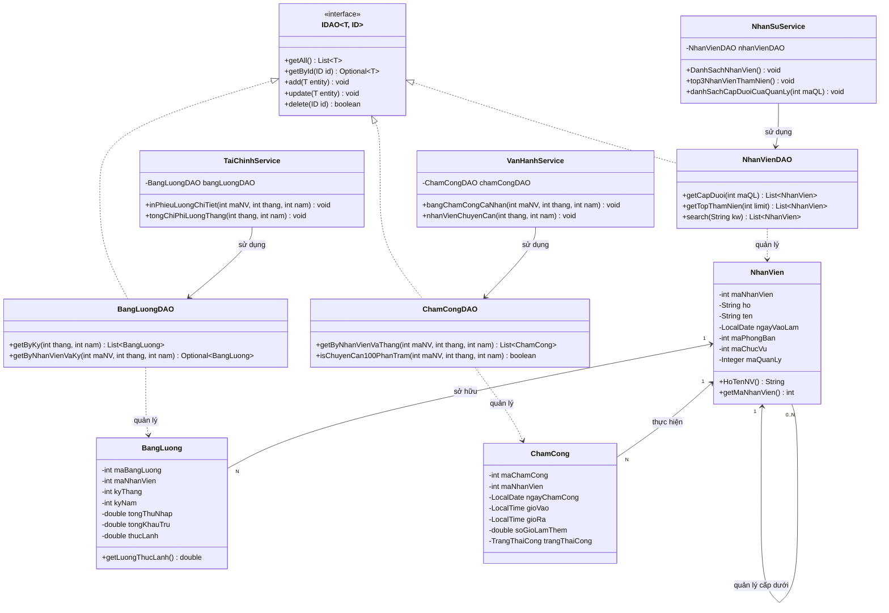

# HRM & TASK MANAGEMENT SYSTEM (HỆ THỐNG QUẢN TRỊ NHÂN SỰ VÀ CÔNG VIỆC)

> Hệ thống Thông tin Quản trị Nhân sự và Vận hành Công việc doanh nghiệp đa nền tảng, được hiện thực hóa song song bằng **Java (JDK 21 / Stream API / Lambdas)** và **C# (.NET 10 / LINQ)**, nhằm giải quyết bài toán số hóa toàn diện hồ sơ nhân sự, tự động hóa chấm công - phân ca, kết toán bảng lương minh bạch và đánh giá hiệu suất (KPI) định kỳ.

---

## 📌 Mục lục
- [Giới thiệu](#-giới-thiệu)
- [Tính năng chính](#-tính-năng-chính)
- [Áp dụng lập trình hướng đối tượng (OOP)](#-áp-dụng-lập-trình-hướng-đối-tượng-oop)
- [Kiến trúc & Sơ đồ lớp (Class Diagram)](#-kiến-trúc--sơ-đồ-lớp-class-diagram)
- [Yêu cầu hệ thống & Công nghệ sử dụng](#-yêu-cầu-hệ-thống--công-nghệ-sử-dụng)
- [Hướng dẫn cài đặt & Chạy chương trình](#-hướng-dẫn-cài-đặt--chạy-chương-trình)
- [Tác giả](#-tác-giả)

---

## 📖 Giới thiệu

Trong các doanh nghiệp hiện đại, nguồn nhân lực là tài sản cốt lõi quyết định năng lực cạnh tranh. Tuy nhiên, công tác quản trị nhân sự truyền thống thông qua sổ sách hoặc các bảng tính rời rạc (Excel) bộc lộ nhiều điểm nghẽn nghiêm trọng:
* Dữ liệu chấm công thủ công phân tán, dễ sai sót và gian lận thời gian làm việc.
* Hợp đồng lao động hết hạn không được cảnh báo kịp thời, dẫn tới rủi ro pháp lý cho doanh nghiệp.
* Quy trình tính lương phức tạp (kết hợp lương cơ bản, phụ cấp trách nhiệm, thưởng làm thêm ngoài giờ OT và các khoản trích nộp bảo hiểm bắt buộc BHXH 10.5%).
* Đánh giá hiệu suất nhân viên (KPI) thiếu minh bạch và không có trọng số đo lường định lượng.

**Hệ thống Quản trị Nhân sự và Công việc (HRM & Task Management System)** được xây dựng nhằm giải quyết triệt để các bài toán trên. Hệ thống thiết lập cơ sở dữ liệu chuẩn hóa gồm 14 thực thể và 10 danh mục Enumeration đạt dạng chuẩn 3NF/BCNF, chia thành 3 phân hệ nghiệp vụ độc lập nhưng liên kết chặt chẽ, đồng thời hiện thực hóa 30 chức năng truy vấn báo cáo chuyên sâu trên cả hai công nghệ hiện đại hàng đầu: **Java Streams** và **C# LINQ**.

---

## 🚀 Tính năng chính

Hệ thống cung cấp đầy đủ 30 chức năng nghiệp vụ được phân rã thành 3 phân hệ chuyên trách:

### 1. Phân hệ Quản trị Nhân sự & Tổ chức (Thành viên 1: Đặng Hoàng Lĩnh)
- **Hồ sơ nhân viên 360°:** Quản lý tập trung thông tin cá nhân, liên lạc, chức danh và phòng ban.
- **Sơ đồ cơ cấu tổ chức:** Thống kê quy mô nhân sự trực thuộc từng phòng ban và nhận diện chức vụ trưởng phòng.
- **Tra cứu đa dạng:** Tra cứu nhân sự theo mã hoặc tên phòng ban (không phân biệt hoa/thường).
- **Vinh danh thâm niên:** Tự động xếp hạng và lọc Top 3 nhân viên có ngày gia nhập công ty sớm nhất.
- **Cây phân cấp quản trị (Self-Reference):** Truy vết chính xác quan hệ cấp trên – cấp dưới trực tiếp trong doanh nghiệp.
- **Quản lý ban dự án:** Quản lý nhóm công tác, thông tin thành viên, ngày tham gia và vai trò dự án.
- **Thống kê nhân sự đa nhiệm:** Tự động phát hiện các nhân viên chủ chốt đang tham gia $\ge 2$ ban dự án.
- **Cân đối vị trí:** Thống kê phân bổ số lượng nhân sự theo từng vị trí chức danh nghề nghiệp.
- **Quản lý tài nguyên nhàn rỗi:** Lọc danh sách các nhân sự mới hoặc chưa được phân bổ vào dự án nào.
- **Tìm kiếm thông minh (Global Search):** 1 từ khóa duy nhất tìm kiếm đồng thời theo Họ tên, Số điện thoại hoặc Email.

### 2. Phân hệ Vận hành & Quản lý Chấm công (Thành viên 2: Nguyễn Sinh Dương)
- **Hợp đồng & Pháp lý:** In chi tiết hợp đồng lao động và phụ lục điều khoản pháp lý đính kèm.
- **Cảnh báo đáo hạn tự động:** Cảnh báo các hợp đồng lao động sẽ hết hạn trong vòng 30 ngày.
- **Lịch sử chấm công tháng:** Tra cứu chi tiết từng ngày công: giờ vào, giờ ra, trạng thái (Đúng giờ, Đi trễ, Về sớm) và giờ OT.
- **Xếp hạng kỷ luật:** Báo cáo top nhân viên vi phạm đi trễ nhiều nhất trong tháng để chấn chỉnh kỷ luật.
- **Ghi nhận cống hiến OT:** Thống kê top nhân viên làm thêm giờ nhiều nhất trong tháng làm căn cứ chi trả phụ cấp.
- **Quy trình phê duyệt nghỉ phép:** Lọc danh sách các đơn xin nghỉ phép đang ở trạng thái `CHO_DUYET`.
- **Hồ sơ nghỉ phép cá nhân:** Truy xuất toàn bộ lịch sử nghỉ phép trong năm của một nhân sự.
- **Tôn vinh chuyên cần 100%:** Tìm kiếm các gương mặt nhân viên đi làm đầy đủ, không trễ/vắng trong tháng.
- **Thống kê loại hợp đồng:** Đo lường cơ cấu tỷ trọng: Hợp đồng thử việc, xác định thời hạn và vô thời hạn.
- **Thanh tra pháp chế:** Lọc toàn bộ các điều khoản thuộc nhóm Bảo mật thông tin hoặc Kỷ luật lao động.

### 3. Phân hệ Quản lý Tài chính, Tiền lương & KPI (Thành viên 3: Nguyễn Gia Hạo)
- **Phiếu lương minh bạch (Payslip):** Xuất phiếu lương cá nhân gồm đầy đủ các dòng hạch toán cộng (Lương CB, Phụ cấp, OT) và trừ (BHXH 10.5%, phạt).
- **Tổng ngân sách lương tháng:** Tự động tính toán tổng số tiền lương toàn công ty cần giải ngân trong kỳ.
- **Quỹ lương theo phòng ban:** Thống kê tổng chi phí lương thực lãnh đã phân bổ về từng phòng ban.
- **Vinh danh thu nhập cao:** Trích xuất Top 3 nhân sự có mức thu nhập thực lãnh cao nhất trong tháng.
- **Bóc tách bảo hiểm bắt buộc:** Thống kê tổng số tiền trích nộp các quỹ BHXH, BHYT, BHTN để nộp cơ quan bảo hiểm.
- **Báo cáo danh mục phụ cấp & thưởng:** Tổng hợp toàn bộ các gói đãi ngộ, tiền thưởng dự án và KPI đã chi trả.
- **Phiếu KPI đa tiêu chí:** Xuất phiếu đánh giá hiệu suất gồm điểm tổng, xếp loại và chi tiết từng tiêu chí có trọng số ($\sum = 1.0$).
- **Phân loại thi đua cuối năm:** Gom nhóm nhân sự theo 4 mức xếp loại: Xuất sắc, Tốt, Trung bình, Yếu.
- **Chiến sĩ thi đua toàn diện:** Tìm kiếm nhân sự đạt KPI Xuất Sắc và không nghỉ phép ngày nào trong năm.
- **Khảo sát đãi ngộ thị trường:** Tính mức thu nhập bình quân (`Average`) theo từng chức danh nghề nghiệp.

---

## 💡 Áp dụng lập trình hướng đối tượng (OOP)

Dự án được xây dựng tuân thủ chặt chẽ 4 nguyên lý cốt lõi của OOP kết hợp các mẫu thiết kế (Design Patterns) chuẩn mực:

### 1. Đóng gói (Encapsulation)
- Toàn bộ 14 lớp Model trong package `com.hrmis.models` đều khai báo các thuộc tính ở phạm vi truy cập an toàn (`private`).
- Dữ liệu được bảo vệ và truy xuất/cập nhật thông qua các phương thức getter/setter hợp lệ trong Java hoặc thuộc tính tự động Auto-properties `{ get; set; }` trong C#.
- *Ví dụ:* Lớp `BangLuong` che giấu các trường tài chính (`tongThuNhap`, `tongKhauTru`, `thucLanh`). Dữ liệu chỉ được cập nhật thông qua quá trình tính toán nghiệp vụ tại tầng Service, ngăn chặn hoàn toàn việc sửa đổi số tiền tùy tiện từ bên ngoài.

### 2. Trừu tượng (Abstraction)
- Định nghĩa giao diện tổng quát `IDAO<T, ID>` trong package `com.hrmis.dao`, trừu tượng hóa các hành vi truy xuất dữ liệu cơ bản (`getAll()`, `getById()`, `add()`, `update()`, `delete()`).
- Tầng Service chỉ tương tác với các hành vi trừu tượng mà không cần quan tâm dữ liệu bên dưới được lưu trữ trong danh sách tĩnh (`DatabaseMock`) hay Cơ sở dữ liệu quan hệ (SQL Server/MySQL).
- Ứng dụng các Functional Interface trừu tượng hóa hành vi tính toán như `SalaryCalculator`, `Predicate<T>`, `Function<T, R>`.

### 3. Kế thừa (Inheritance)
- Toàn bộ 14 lớp DAO cụ thể (`NhanVienDAO`, `PhongBanDAO`, `BangLuongDAO`...) đều kế thừa và triển khai các phương thức được định nghĩa từ giao diện cơ sở `IDAO<T, ID>`.
- Cho phép tái sử dụng cấu trúc mã nguồn, đảm bảo mọi lớp truy xuất dữ liệu trong hệ thống đều tuân thủ một chuẩn giao tiếp thống nhất.

### 4. Đa hình (Polymorphism)
- **Ghi đè phương thức (Method Overriding):** 
  - Các lớp Model ghi đè phương thức `toString()` để phục vụ việc in vết và gỡ lỗi.
  - Các lớp DAO triển khai và ghi đè các hàm của `IDAO<T, ID>` theo logic nghiệp vụ của từng thực thể tương ứng.
- **Đa hình giao diện (Interface-based Polymorphism):** 
  - Khai báo biến dưới dạng kiểu interface: `IDAO<NhanVien, Integer> dao = new NhanVienDAO();`.
- **Đa hình tham số (Parametric Polymorphism / Generics):**
  - Giao diện `IDAO<T, ID>` có khả năng tái sử dụng cho mọi loại thực thể `T` với các kiểu khóa chính `ID` khác nhau (`Integer`, `CompositeKey`).

### 5. Design Patterns đã áp dụng
* **Data Access Object (DAO) Pattern:** Đóng vai trò là tầng trung gian duy nhất giao tiếp với kho dữ liệu. Giúp tách biệt triệt để mã nguồn xử lý nghiệp vụ (Service) khỏi mã nguồn truy xuất dữ liệu (Data Access), đạt nguyên lý **Khớp nối lỏng lẻo (Loose Coupling)** và **Đơn trách nhiệm (Single Responsibility Principle)**.
* **Strategy Pattern (Chiến lược):** Ứng dụng thông qua các biểu thức Lambda và Functional Interface (`SalaryCalculator`, `Comparator.comparing()`) cho phép hoán đổi thuật toán tính lương hoặc tiêu chí sắp xếp linh hoạt ngay tại thời điểm thực thi.
* **3-Layer Architecture Pattern:** Phân chia kiến trúc hệ thống thành 3 tầng rành mạch: *Presentation Layer $\to$ Business Logic / Service Layer $\to$ Data Access Layer (DAO)*.

---

## 📐 Kiến trúc & Sơ đồ lớp (Class Diagram)

### 1. Kiến trúc phân tầng (3-Layer Architecture)
```
+--------------------------------------------------------------------------+
|                     TẦNG TRÌNH DIỄN (PRESENTATION)                       |
|           Java: Main.java               |          C#: Program.cs        |
|     (Menu Console tương tác, điều hướng 30 câu hỏi, nhập xuất dữ liệu)   |
+--------------------------------------------------------------------------+
                                     |
                                     v
+--------------------------------------------------------------------------+
|                     TẦNG NGHIỆP VỤ (SERVICE LAYER)                       |
|   - NhanSuService.java                  |    - NhanSuService.cs (Lĩnh)   |
|   - VanHanhService.java                 |    - VanHanhService.cs (Dương) |
|   - TaiChinhService.java                |    - TaiChinhService.cs (Hạo)  |
+--------------------------------------------------------------------------+
                                     |
                                     v
+--------------------------------------------------------------------------+
|                TẦNG TRUY XUẤT DỮ LIỆU (DAO LAYER - IDAO<T, ID>)          |
|    NhanVienDAO, PhongBanDAO, HopDongDAO, ChamCongDAO, BangLuongDAO...    |
+--------------------------------------------------------------------------+
                                     |
                                     v
+--------------------------------------------------------------------------+
|                     TẦNG DỮ LIỆU (DATABASE / STORAGE)                    |
|             DatabaseMock.java           |       DatabaseMock.cs          |
|            (14 danh sách thực thể dữ liệu mẫu chuẩn hóa 3NF)             |
+--------------------------------------------------------------------------+
```

### 2. Sơ đồ lớp cốt lõi (Class Diagram bằng Mermaid)



---

## 💻 Yêu cầu hệ thống & Công nghệ sử dụng

### 1. Môi trường yêu cầu
- **Đối với Java:** Java Development Kit (**JDK 17** hoặc **JDK 21 LTS**).
- **Đối với C#:** **.NET SDK 10.0** (hoặc tương thích ngược với .NET 8.0 / 9.0).
- **Hệ điều hành:** Microsoft Windows 10/11, macOS hoặc Linux.
- **Bộ nhớ RAM:** Tối thiểu 4GB RAM (khuyến nghị 8GB RAM).

### 2. Công nghệ và Thư viện cốt lõi
* **Ngôn ngữ Java:**
  * Java SE 21 (LTS).
  * Java Stream API, Biểu thức Lambda (`->`), Method Reference (`::`).
  * Gói thời gian hiện đại: `java.time.LocalDate`, `LocalTime`, `ChronoUnit`.
  * Bộ thu hoạch nâng cao: `Collectors.groupingBy()`, `summingDouble()`, `counting()`, `joining()`.
  * Xử lý an toàn: `java.util.Optional`.
* **Ngôn ngữ C#:**
  * C# 10 / .NET 10.
  * LINQ (Language-Integrated Query) với cú pháp Extension Method: `.Where()`, `.Select()`, `.GroupBy()`, `.OrderBy()`, `.Sum()`, `.Average()`.
  * Cú pháp biểu thức Lambda (`=>`), Null-conditional (`?.`), Nullable Value Types (`int?`).
  * Kiểu thời gian chuẩn: `System.DateOnly`, `System.TimeOnly`.

---

## 🛠 Hướng dẫn cài đặt & Chạy chương trình

### 1. Chạy phiên bản JAVA
1. Mở cửa sổ dòng lệnh (Terminal / Command Prompt / PowerShell) và điều hướng vào thư mục dự án Java:
   ```bash
   cd "c:\Users\DUONG\Downloads\HR\HRM & Task Management"
   ```
2. Biên dịch toàn bộ mã nguồn sang thư mục `bin`:
   ```bash
   javac -encoding UTF-8 -d bin -sourcepath src src/com/hrmis/Main.java
   ```
3. Khởi chạy ứng dụng:
   ```bash
   java -cp bin com.hrmis.Main
   ```

---

### 2. Chạy phiên bản C# (.NET)
1. Mở cửa sổ dòng lệnh và điều hướng vào thư mục dự án C#:
   ```bash
   cd "C:\Users\DUONG\Downloads\HRc#\OOP_HRM-TaskManagement_C-Sharp\OOP_HRM-TaskManagement_C-Sharp"
   ```
2. Khởi chạy trực tiếp bằng lệnh `dotnet`:
   ```bash
   dotnet run
   ```

---

### 3. Hướng dẫn tương tác với Menu Console
Khi chương trình khởi chạy thành công, màn hình sẽ hiển thị bảng điều khiển **MENU TRUY VẤN DỮ LIỆU HRM (30 CÂU)**:
```
========================================================================================
             HỆ THỐNG QUẢN TRỊ NHÂN SỰ VÀ CÔNG VIỆC (HRM & TASK MANAGEMENT)
========================================================================================
[1-10]  PHÂN HỆ 1: NHÂN SỰ & TỔ CHỨC       (Đặng Hoàng Lĩnh)
[11-20] PHÂN HỆ 2: VẬN HÀNH & CHẤM CÔNG    (Nguyễn Sinh Dương)
[21-30] PHÂN HỆ 3: TÀI CHÍNH & HIỆU SUẤT   (Nguyễn Gia Hạo)
----------------------------------------------------------------------------------------
Nhập số thứ tự câu hỏi cần chạy (1 - 30) hoặc nhập 0 để thoát chương trình:
```
* **Để xem kết quả câu truy vấn:** Nhập số từ `1` đến `30` và nhấn `Enter`.
* **Các câu hỗ trợ nhập dữ liệu:**
  * Câu 3: Nhập mã phòng ban (VD: `1`) hoặc từ khóa tên phòng (VD: `Cong nghe`).
  * Câu 5: Nhập mã người quản lý (VD: `1` để xem cấp dưới của Giám đốc).
  * Câu 10: Nhập từ khóa tìm kiếm nhân viên (VD: `Linh`, `0901`, `cntt`).
* **Để kết thúc:** Nhập `0` và nhấn `Enter`.

---

## 👥 Tác giả

Đồ án được thực hiện bởi nhóm sinh viên Khoa Công Nghệ Thông Tin dưới sự hướng dẫn khoa học của:
* **Giảng viên hướng dẫn:** Thầy Nguyễn Minh Đạo

### Thành viên nhóm thực hiện:
1. **Đặng Hoàng Lĩnh** – **MSSV: 25162073**
   * *Phụ trách:* Phân hệ 1 (Quản trị Nhân sự, Phòng ban, Chức vụ & Đội nhóm dự án - Câu 1 $\to$ 10).
2. **Nguyễn Sinh Dương** – **MSSV: 25162019**
   * *Phụ trách:* Điều phối cấu trúc hệ thống, Phân hệ 2 (Vận hành, Hợp đồng lao động & Quản lý Chấm công - Câu 11 $\to$ 20).
3. **Nguyễn Gia Hạo** – **MSSV: 25162030**
   * *Phụ trách:* Phân hệ 3 (Quản trị Tài chính, Kết toán bảng lương & Đánh giá hiệu suất KPI - Câu 21 $\to$ 30).
